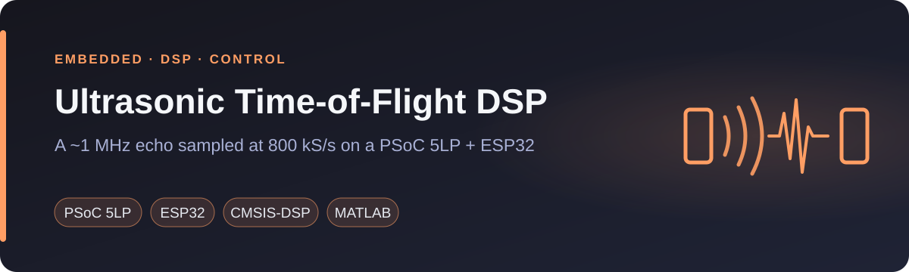
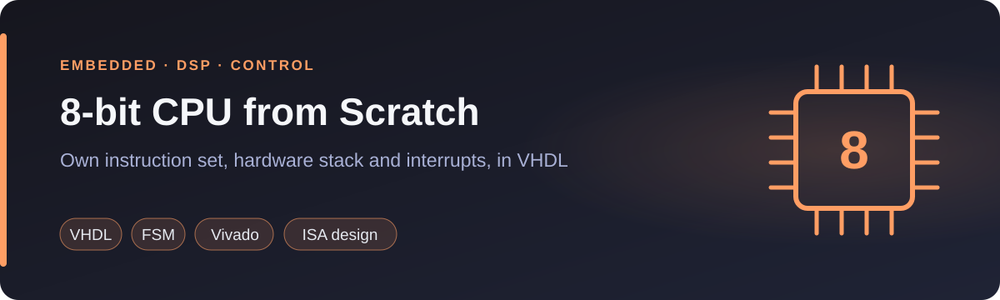

📍 Asunción, Paraguay · Spanish (native) · English (advanced)

<a href="#english">English</a> · <a href="#español">Español</a>

---

## English

I am an electronics engineer finishing an MSc in Artificial Intelligence (December 2026). My work sits in two places: signal processing and control on microcontrollers, and machine learning models that run on their own, outside a notebook. Since 2022 I have been a researcher at the Catholic University of Asunción, on projects funded by CONACYT, and I teach signal processing and programming.

- **Research:** a low-cost ultrasonic flow meter, published at **IEEE CHILECON 2025**. Two papers as first author accepted for November 2026: **IEEE URUCON** and **IBERAMIA**.
- **MSc thesis:** I built a Python service that forecasts the level of an urban stream in Asunción 10 to 30 minutes ahead, with uncertainty intervals.
- **Teaching:** Digital Signal Processing, Electronics II and Introduction to Algorithms (Python).

### Embedded, DSP and control

<table>
<tr><td width="50%" valign="top"> <b>Engineering thesis</b> · Arrival time of an ultrasonic echo, measured below the Nyquist rate. Sampling-clock jitter cut from about 29 ns to 4 ns. IEEE CHILECON 2025.</td><td width="50%" valign="top"> <b>2022</b> · Eight controllers tested on the real rig. The current estimator worked best. LQR failed because the actuator saturated, and the README explains why. With Daniel Barboza.</td></tr>
<tr><td width="50%" valign="top"> <b>Course project</b> · The chip's filter block had only two channels, so I wrote the third band by hand as a 15-tap FIR in C.</td><td width="50%" valign="top"> <b>2020</b> · Three addressing modes, a hardware stack and interrupts, run by a 52-state control FSM. Verified in simulation.</td></tr>
</table>

Also: [a VGA controller in VHDL for a MIPS soft core](https://github.com/fedemoranf-alt/mips-vga-soc) (2021), with a game written in MIPS assembly.

### Machine learning and data

<table>
<tr><td width="50%" valign="top"> <b>2026</b> · Seven models compared with metrics on flood peaks, not only on averages. The LSTM gave the best overall balance. IBERAMIA 2026.</td><td width="50%" valign="top"> <b>2026</b> · From 17 to 35 FPS on a laptop CPU. I found and fixed a leak between training and test data. <a href="https://huggingface.co/spaces/fedemoranf/TPF-DeepLearning-FedericoMoran">Live demo</a>.</td></tr>
<tr><td width="50%" valign="top"> <b>2026</b> · Approaches one object and flees from another, with safety first. Everything is decided on board. 79 automated checks and a simulator. With Juan Barboza.</td><td width="50%" valign="top"> <b>2026</b> · 440 wholesale customers. Each segment points to an action: retention, cross-selling or delivery planning. With Juan Barboza.</td></tr>
</table>

Also: [the public output of my thesis forecasting service](https://github.com/fedemoranf-alt/mburicao-pronostico), which a project website reads to plot the forecast. The service code is private.

### Experience

- **Researcher, Signal Processing and Embedded Systems**, Catholic University "Nuestra Señora de la Asunción" (August 2022 to present). Projects funded by CONACYT. Signal-processing algorithms in Python and MATLAB, implemented in C on microcontrollers.
- **Lecturer and teaching assistant**, Catholic University "Nuestra Señora de la Asunción" and National University of Asunción (2024 to present). Digital Signal Processing, Electronics II and Introduction to Algorithms (Python).

### Publications

- *Event-Conditional Calibration of Conformal Prediction Intervals for Urban Stream Nowcasting.* IEEE URUCON 2026, Montevideo. First author. Accepted, to appear.
- *Event-Centered Short-Term Forecasting of Urban Stream Levels.* IBERAMIA 2026, Asunción. First author. Accepted, to appear.
- [*A Reconfigurable Embedded Platform for Accurate Ultrasonic TOF Estimation.*](https://doi.org/10.1109/CHILECON66915.2025.11476040) IEEE CHILECON 2025. Co-author.

### Toolbox

**Embedded:** C · C++ · PSoC 5LP (ARM Cortex-M3) · ESP32 · Raspberry Pi 5 · ADC/DAC · DMA · UART · CMSIS-DSP · PlatformIO 
**Signals and control:** FIR/IIR design · cross-correlation · bandpass sampling · PID · state-space control · state estimators · Kalman filter 
**Machine learning:** Python · pandas · NumPy · scikit-learn · PyTorch · YOLOv8 · OpenVINO · time series · clustering · conformal prediction 
**Tools:** Linux · cron · Docker Compose · MySQL · pytest · Git · GitHub Actions · MATLAB · VHDL · LaTeX

### Education

- **MSc in Artificial Intelligence**, Faculty of Engineering, National University of Asunción (expected December 2026)
- **Electronic Engineering**, Catholic University "Nuestra Señora de la Asunción" (2025)

---

## Español

Soy ingeniero electrónico y estoy terminando la Maestría en Inteligencia Artificial (diciembre de 2026). Trabajo en dos frentes: procesamiento de señales y control sobre microcontroladores, y modelos de machine learning que funcionan solos, fuera de un notebook. Desde 2022 soy investigador en la Universidad Católica de Asunción, en proyectos financiados por el CONACYT, y doy clases de procesamiento de señales y programación.

- **Investigación:** un caudalímetro ultrasónico de bajo costo, publicado en **IEEE CHILECON 2025**. Dos artículos como primer autor aceptados para noviembre de 2026: **IEEE URUCON** e **IBERAMIA**.
- **Tesis de maestría:** desarrollé un servicio en Python que pronostica el nivel de un arroyo urbano de Asunción a 10, 20 y 30 minutos, con intervalos de incertidumbre.
- **Docencia:** Procesamiento Digital de Señales, Electrónica II e Introducción a los Algoritmos (Python).

### Embebidos, DSP y control

<table>
<tr><td width="50%" valign="top"> <b>Tesis de grado</b> · Tiempo de llegada de un eco ultrasónico, medido por debajo de la tasa de Nyquist. El jitter del reloj de muestreo bajó de unos 29 ns a 4 ns. IEEE CHILECON 2025.</td><td width="50%" valign="top"> <b>2022</b> · Ocho controladores probados en la maqueta real. El mejor fue el estimador actual. El LQR falló porque el actuador se saturaba, y el README explica por qué. Con Daniel Barboza.</td></tr>
<tr><td width="50%" valign="top"> <b>Proyecto de materia</b> · El bloque de filtros del chip tenía solo dos canales, así que escribí la tercera banda a mano, como un FIR de 15 coeficientes en C.</td><td width="50%" valign="top"> <b>2020</b> · Tres modos de direccionamiento, pila por hardware e interrupciones, manejados por una máquina de 52 estados. Verificado en simulación.</td></tr>
</table>

También: [un controlador VGA en VHDL para un procesador MIPS](https://github.com/fedemoranf-alt/mips-vga-soc) (2021), con un juego escrito en ensamblador MIPS.

### Machine learning y datos

<table>
<tr><td width="50%" valign="top"> <b>2026</b> · Siete modelos comparados con métricas sobre los picos de crecida, no solo sobre el promedio. El LSTM logró el mejor equilibrio. IBERAMIA 2026.</td><td width="50%" valign="top"> <b>2026</b> · De 17 a 35 cuadros por segundo en el CPU de una notebook. Encontré y corregí una fuga de datos entre entrenamiento y prueba. <a href="https://huggingface.co/spaces/fedemoranf/TPF-DeepLearning-FedericoMoran">Demo en línea</a>.</td></tr>
<tr><td width="50%" valign="top"> <b>2026</b> · Se acerca a un objeto y huye de otro, con la seguridad primero. Todo se decide a bordo. 79 verificaciones automáticas y un simulador. Con Juan Barboza.</td><td width="50%" valign="top"> <b>2026</b> · 440 clientes mayoristas. Cada segmento lleva a una acción: retención, venta cruzada o planificación del reparto. Con Juan Barboza.</td></tr>
</table>

También: [la salida pública del servicio de pronóstico de mi tesis](https://github.com/fedemoranf-alt/mburicao-pronostico), que lee la página de un proyecto para dibujar el pronóstico. El código del servicio es privado.

### Experiencia

- **Investigador en Procesamiento de Señales y Sistemas Embebidos**, Universidad Católica "Nuestra Señora de la Asunción" (agosto de 2022 a la actualidad). Proyectos financiados por el CONACYT. Algoritmos de procesamiento de señales en Python y MATLAB, implementados en C sobre microcontroladores.
- **Docente y auxiliar de enseñanza**, Universidad Católica "Nuestra Señora de la Asunción" y Universidad Nacional de Asunción (2024 a la actualidad). Procesamiento Digital de Señales, Electrónica II e Introducción a los Algoritmos (Python).

### Publicaciones

- *Event-Conditional Calibration of Conformal Prediction Intervals for Urban Stream Nowcasting.* IEEE URUCON 2026, Montevideo. Primer autor. Aceptado, en prensa.
- *Event-Centered Short-Term Forecasting of Urban Stream Levels.* IBERAMIA 2026, Asunción. Primer autor. Aceptado, en prensa.
- [*A Reconfigurable Embedded Platform for Accurate Ultrasonic TOF Estimation.*](https://doi.org/10.1109/CHILECON66915.2025.11476040) IEEE CHILECON 2025. Coautor.

### Herramientas

**Embebidos:** C · C++ · PSoC 5LP (ARM Cortex-M3) · ESP32 · Raspberry Pi 5 · ADC/DAC · DMA · UART · CMSIS-DSP · PlatformIO 
**Señales y control:** diseño FIR/IIR · correlación cruzada · muestreo pasabanda · PID · control en espacio de estados · estimadores de estado · filtro de Kalman 
**Machine learning:** Python · pandas · NumPy · scikit-learn · PyTorch · YOLOv8 · OpenVINO · series temporales · clustering · predicción conformal 
**Herramientas:** Linux · cron · Docker Compose · MySQL · pytest · Git · GitHub Actions · MATLAB · VHDL · LaTeX

### Formación

- **Maestría en Inteligencia Artificial**, Facultad de Ingeniería, Universidad Nacional de Asunción (egreso previsto: diciembre de 2026)
- **Ingeniería Electrónica**, Universidad Católica "Nuestra Señora de la Asunción" (2025)

### Contacto

- LinkedIn: [Federico Morán](https://www.linkedin.com/in/federico-mor%C3%A1n-a9b95a231/)
- Correo: [fedemoranf@gmail.com](mailto:fedemoranf@gmail.com)
